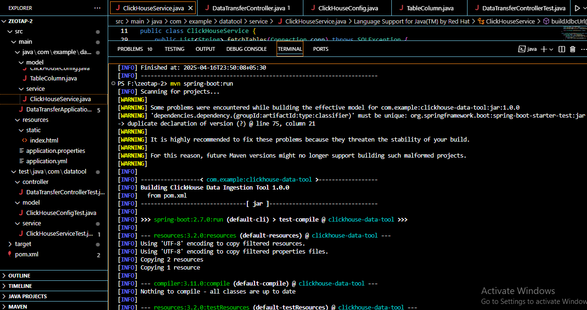
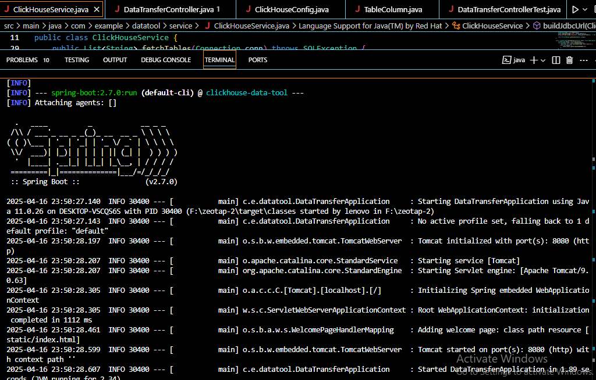
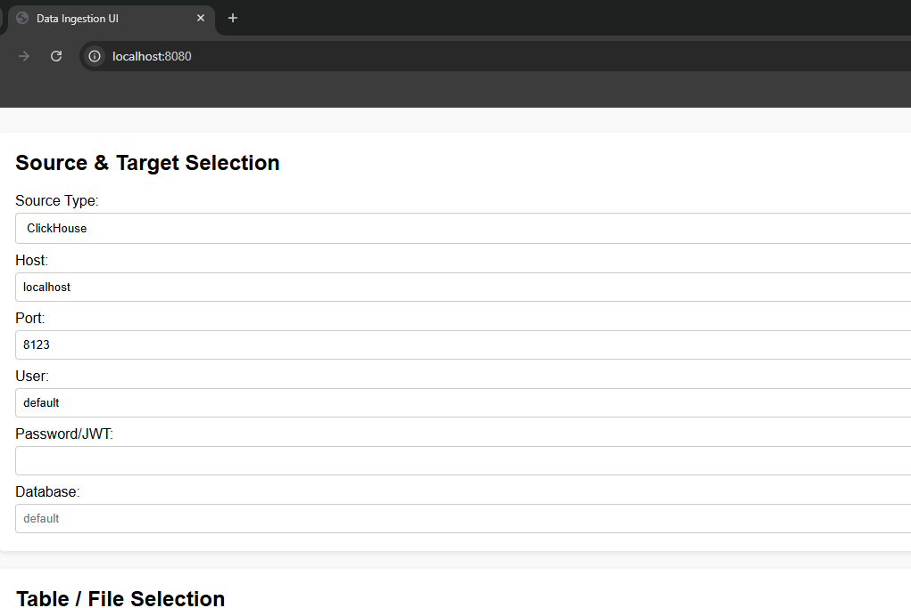
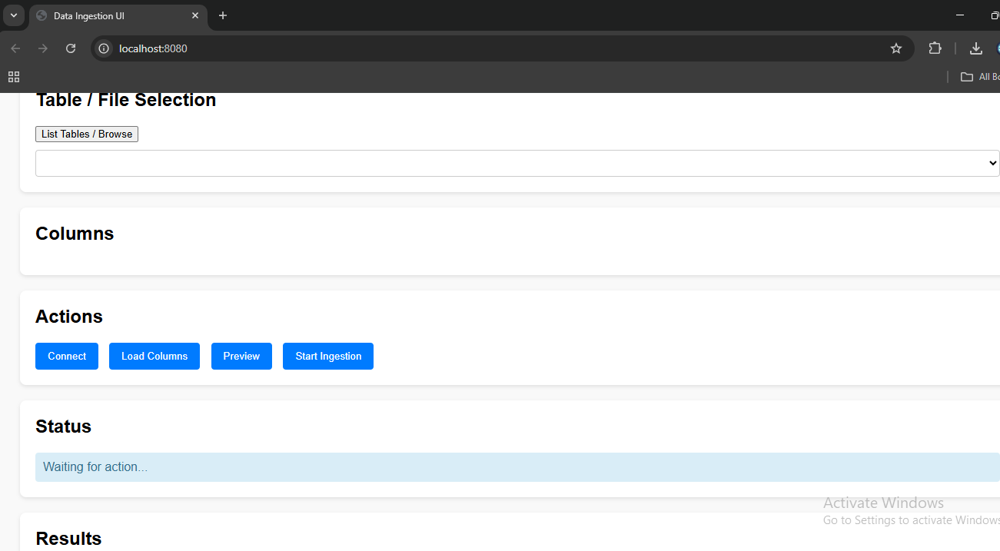

# FlatHouse

**Export ClickHouse tables to flat files through a simple web UI.**

FlatHouse is a Spring Boot application that moves data from a ClickHouse database into CSV flat files. Users connect with JWT-based authentication, pick a table, choose exactly which columns to export, and get a record count when the job completes.

   

---

## Features

- **ClickHouse → Flat File** — export a table (or selected columns) to CSV
- **Flat File → ClickHouse** — upload flow is in the UI; the backend `/api/import` endpoint is on the roadmap
- **JWT authentication** for the ClickHouse source connection
- **Column selection** — list a table's columns and choose which ones to ingest
- **Completion report** — total number of records processed
- **Unit tests** for the controller, model and service layers (JUnit + Mockito)

## Screenshots

| | |
|---|---|
|  |  |
|  |  |

## REST API

| Method | Endpoint | Description |
|---|---|---|
| `POST` | `/api/connect` | Connect to ClickHouse (host, port, database, user, JWT) and list tables |
| `POST` | `/api/get-columns?table=<name>` | List columns of a table |
| `POST` | `/api/export` | Export selected columns to CSV |

## Project Structure

```
FlatHouse/
├── pom.xml
└── src/
    ├── main/java/com/example/datatool/
    │   ├── DataTransferApplication.java
    │   ├── controller/DataTransferController.java
    │   ├── model/{ClickHouseConfig, TableColumn}.java
    │   └── service/ClickHouseService.java
    ├── main/resources/
    │   ├── application.yml
    │   └── static/index.html          # Web UI
    └── test/java/...                   # Unit tests
```

## Getting Started

**Prerequisites:** JDK 11+, Maven, and a reachable ClickHouse instance (e.g. `docker run -p 8123:8123 clickhouse/clickhouse-server`).

```bash
git clone https://github.com/kaviya-ns/FlatHouse.git
cd FlatHouse
mvn spring-boot:run
```

Open <http://localhost:8080>, enter your ClickHouse connection details (default port 8123; 8443/9440 use HTTPS), and start an export.

Run the tests:

```bash
mvn test
```
